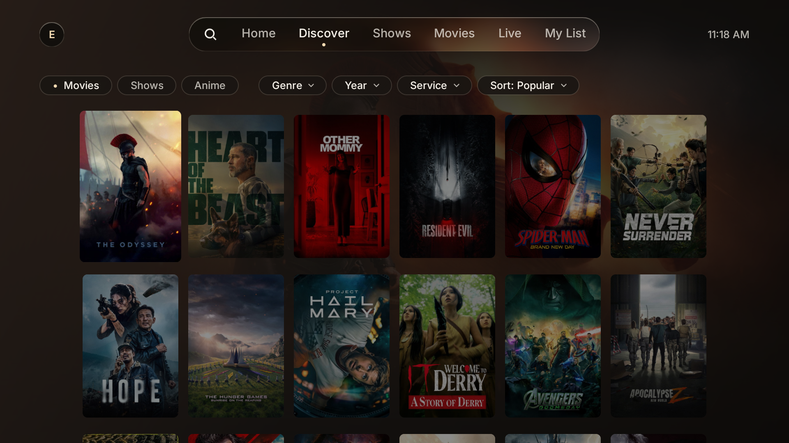
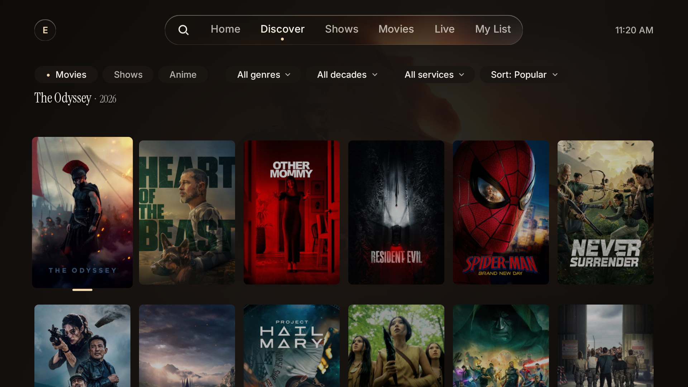
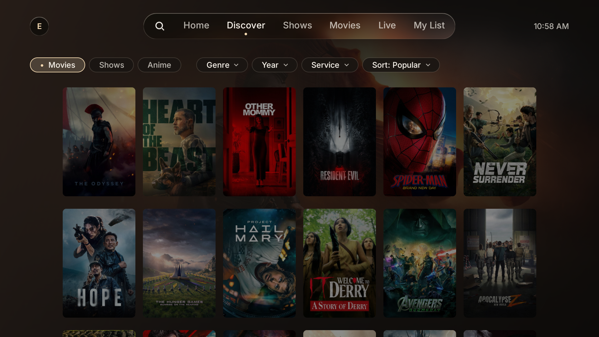
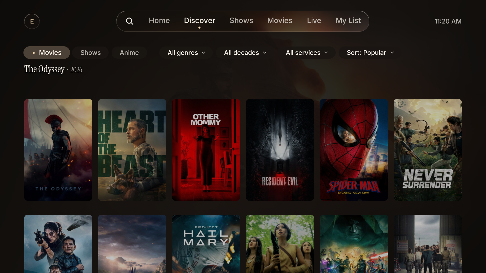
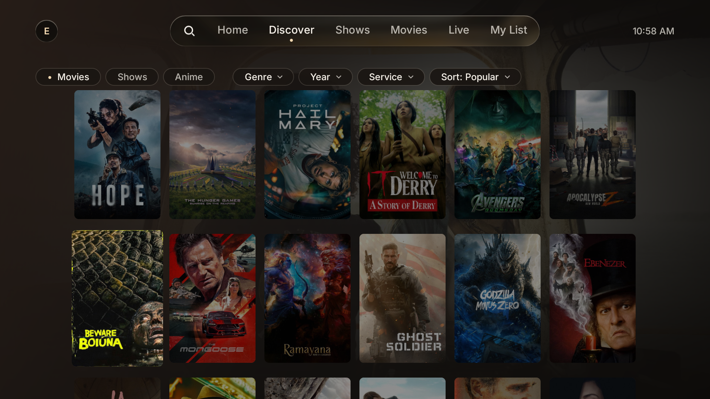
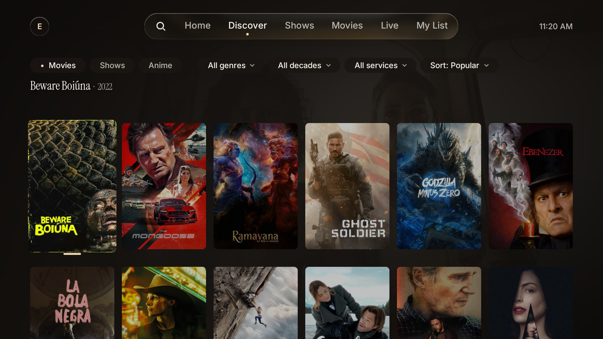
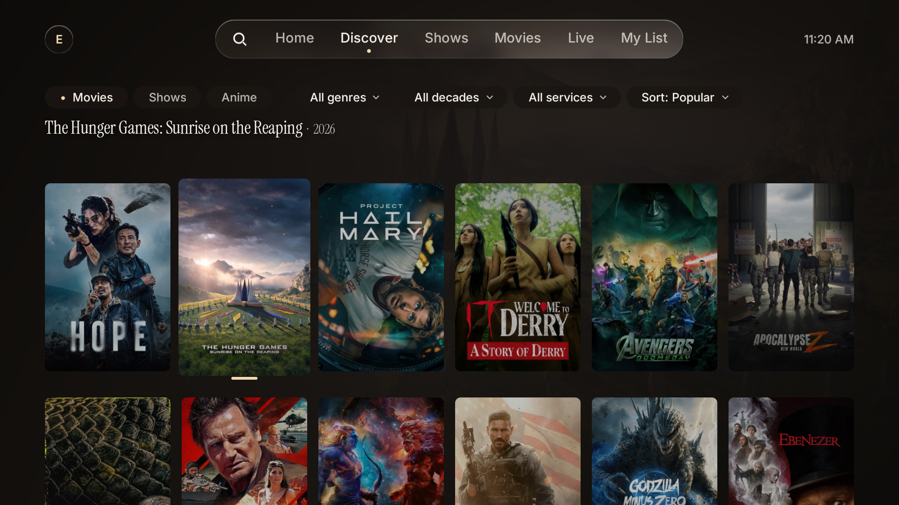

# Discover grid and remote navigation

Verified through ADB on the SmartTV 4K at 1920 × 1080. Before images use unchanged main at `2a035c7`. Both builds use the same TV, profile, and Movies / Popular query.

## Design decisions

| Area | Result |
| --- | --- |
| Poster grid | Six centered columns fill the safe horizontal width. The next row can peek below the viewport instead of shrinking posters to fit two full rows. |
| Focused title | The existing hero shows only the title and year. Its full-width container supports two lines and uses the House Lights type scale. |
| Poster brightness | Unfocused Discover posters have a 25% black shade instead of 45%. The focused poster remains at full brightness. |
| Card focus | A 1.05× scale and the existing short tungsten marker identify the focused poster. No focus border, ring, or glow is added. |
| Filter focus | A filled warm surface and a small scale change show focus. The media-type dot remains selected when focus moves away. |
| Spacing and scrolling | The title and controls have reserved space. A newly revealed row snaps to the top so the previous row does not remain half-cut. The next row peeks below. |
| Filter labels | All genres, All decades, and All services make defaults explicit. Decade matches the available choices. Labels cover all eight app languages. |
| Backdrop | A darker warm shade keeps posters dominant. The existing delay still waits for focus to settle before updating artwork. |
| D-pad navigation | Up and Back return to the remembered filter. Down restores the previous poster. Stable filter keys preserve focus when the service chip appears or disappears. |

## Before and after

| State | Before | After |
| --- | --- | --- |
| First poster |  |  |
| Filter focus |  |  |
| Scrolled grid |  |  |

The full focused title stays readable after scrolling:

## Verification

- `gradlew.bat testDebugUnitTest assembleRelease`: 185 tests passed; signed release build passed, including release vital lint.
- Regression tests cover scrolling with less than two rows of space, bottom clearance, and filter restoration when the service chip changes.
- ADB assertions verified six balanced columns, full hero width, horizontal movement, column preservation, and fully visible focused posters.
- Back to filters and Down to the grid restored the same poster and scroll position. Opening a title page and returning restored the same poster.
- Genre and decade selection and clearing restored filter focus. Service and Sort menus cancelled back to their chips.
- Right stopped at the last filter. Up to Discover and Down restored the last filter.
- Movies, Shows, and Anime switched correctly and retained selected semantics. The original query was restored after the checks.
- Debug lint reports 32 errors and 86 warnings. An independent unchanged-main checkout reports identical issue IDs, messages, severities, and source files.

Shared changes also affect My List's grid scale and scrolling, filter surfaces, and Decade label. Other chip users receive the selected accessibility state.

Not verified: other TV resolutions, maximum system font scaling, or TalkBack. Playback was not exercised.
